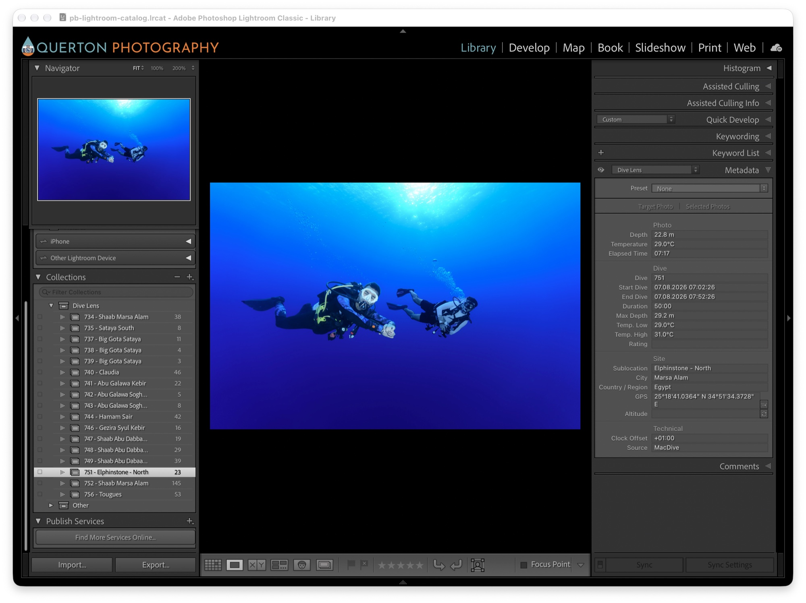
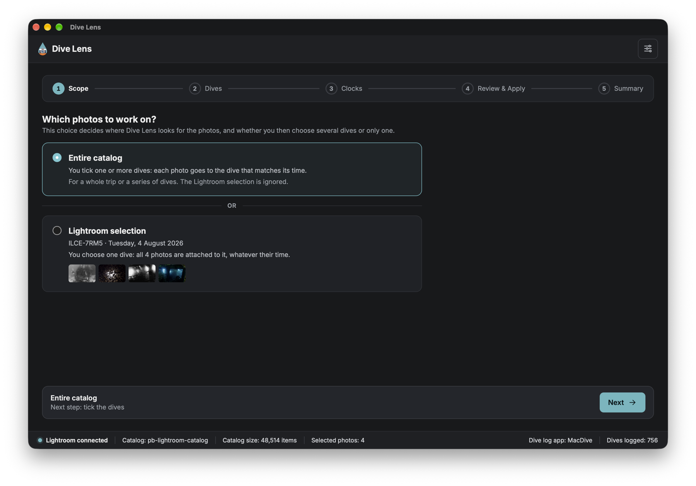
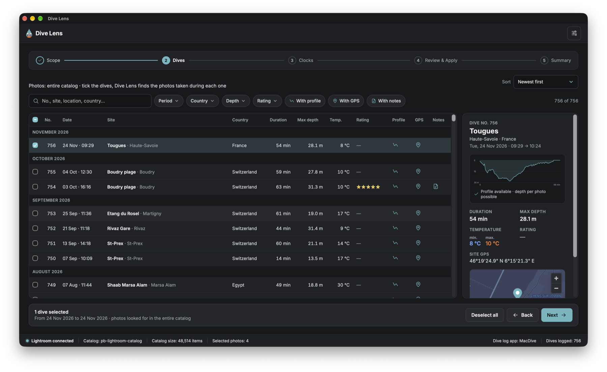
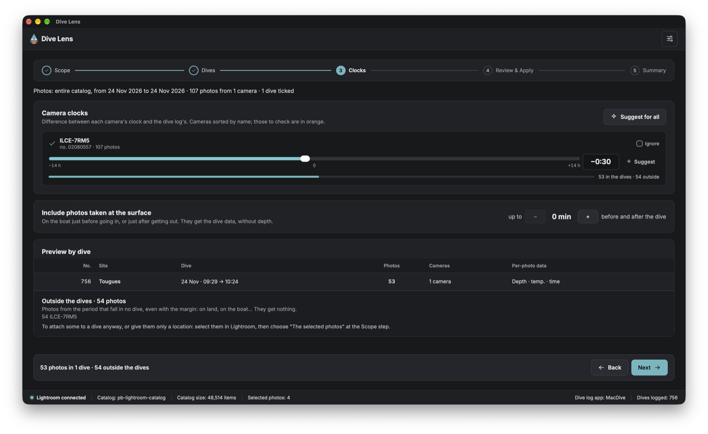
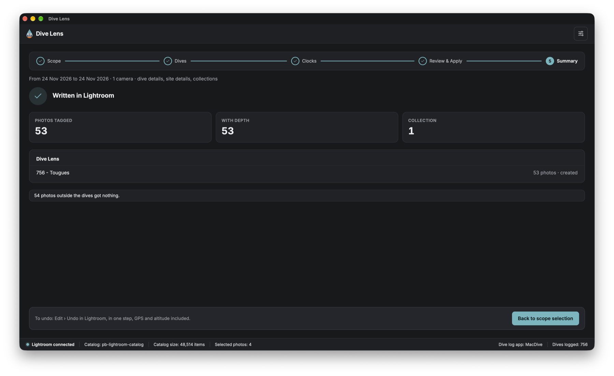

# Dive Lens

**Your underwater photos, linked to your dive log, right inside Lightroom Classic.**

[**Download**](https://github.com/Ventrilok/divelens/releases/latest) ·
User guide: [English](docs/user/en.md) · [Français](docs/user/fr.md) · [Deutsch](docs/user/de.md) ·
[Report a problem](https://github.com/Ventrilok/divelens/issues/new/choose)

## Why Dive Lens

Back from a trip, you have hundreds of photos and a dive log, and nothing connects them. How deep were you when you took that shot? Which dive was it, on which site?

Dive Lens reads your dive log, matches each photo to its dive by its capture time, and writes the answers in your Lightroom catalog.

## What you get

- **The moment of each shot:** depth, water temperature and time into the dive, when the dive has a profile.
- **The dive:** number, start and end, duration, max depth, temperatures and rating.
- **The site:** its name, city, country and GPS position, in Lightroom's standard location fields.
- **One collection per dive**, such as "42 - Blue Reef".
- **Whole trips or a few photos:** let Dive Lens sort the entire catalog by time, or attach the photos you selected to one dive, or give them only a location.

## How it works

In Lightroom, choose **Library › Plug-in Extras › Open Dive Lens…**. The Dive Lens app opens and guides you through five steps.

### 1. Choose the photos

The entire catalog, or the photos selected in Lightroom.

### 2. Pick your dives

Search and filter your log, with the profile, site and map of each dive.

### 3. Set the camera clocks

A camera is rarely on time with the dive computer, and is often still on the time of home. **Suggest** finds the offset for each camera, and a preview shows how many photos fall in each dive.

### 4. Review and apply

Choose what gets written: dive details, site details, collections, and if you wish the depth as GPS altitude. Nothing is written before you click **Apply**.

### 5. Done

A summary of what was written. Changed your mind? One **Edit › Undo** in Lightroom takes it all back.

## Install

You need Lightroom Classic and your dive application on the same computer.

1. Quit Lightroom.
2. Download the installer from the [latest release](https://github.com/Ventrilok/divelens/releases/latest): `.pkg` for macOS, `Setup.exe` for Windows. No administrator password needed.
3. Start Lightroom: Dive Lens is in **Library › Plug-in Extras**.

The Windows installer is not signed yet: if Windows shows "Windows protected your PC", click **More info**, then **Run anyway**.

The [user guide](docs/user/en.md#1-install) also covers the zip install, uninstalling, and moving from the 0.x plug-in.

## Compatibility

| | |
|---|---|
| **Dive logs** | MacDive (macOS), Subsurface (macOS and Windows) |
| **Computers** | macOS (Intel and Apple Silicon), Windows |
| **Lightroom** | Lightroom Classic 14 or later |
| **Languages** | English, French, German |

BlueDive and Submersion are planned next. Using another dive application? [Ask for it](https://github.com/Ventrilok/divelens/issues/new/choose).

## Your data stays yours

- Your dive log is **read directly and never modified**. Nothing to export.
- **No dive data is sent anywhere.** Dive Lens goes online only for the site map and for updates ([details](docs/user/en.md#12-privacy)).

## License

Dive Lens is free and open source, under the [GNU General Public License v3.0](LICENSE). It includes [libdivecomputer](https://www.libdivecomputer.org) (LGPL 2.1, in `third_party/libdivecomputer`) to decode dive-computer data.
